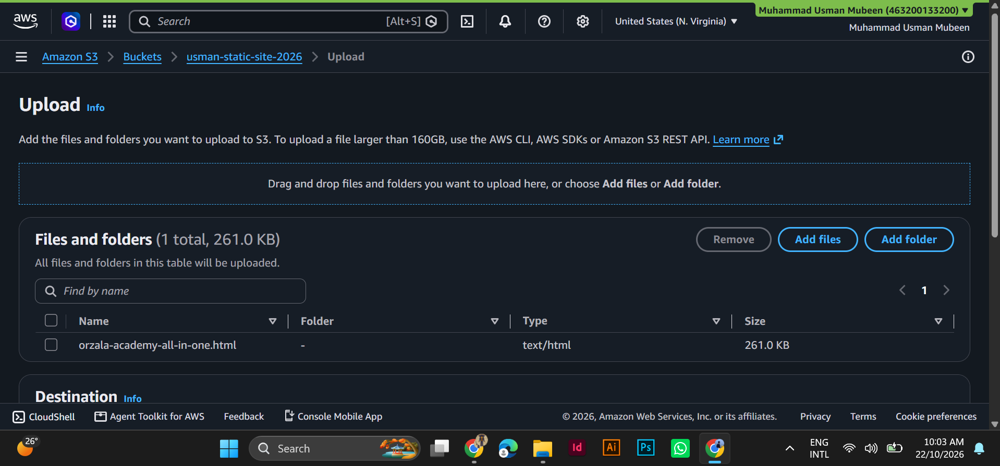
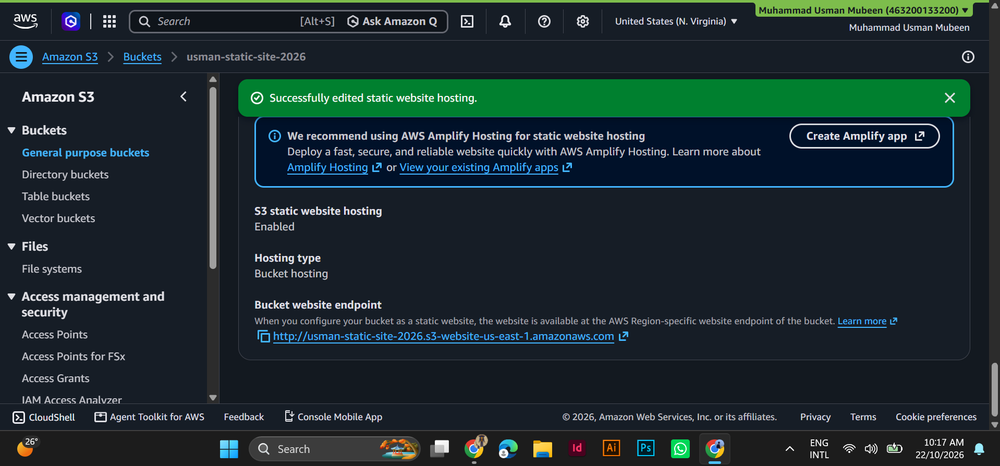
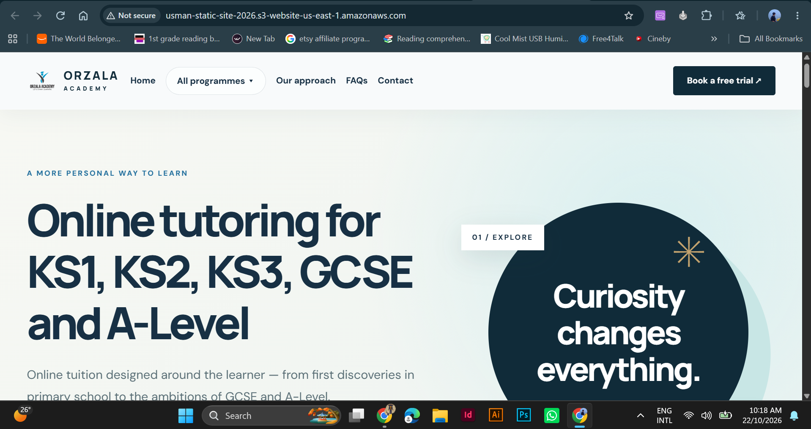
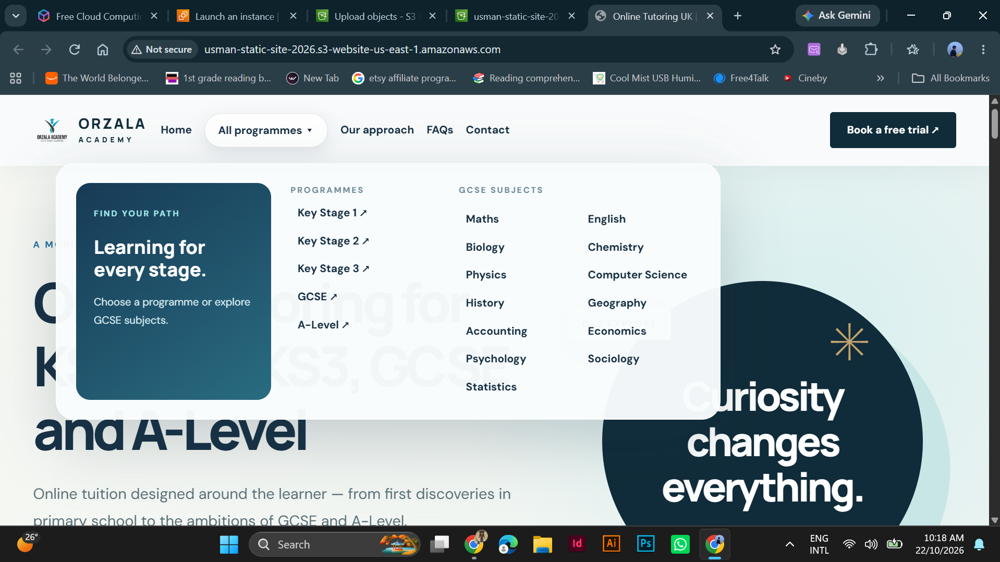

# AWS S3 Static Website Hosting

A hands-on project where I hosted a static HTML website on Amazon S3 and made it publicly accessible over the internet using S3 static website hosting and a bucket policy.

## Goal

Learn how to host a static website without running a server: create an S3 bucket, upload site files, enable static website hosting, and control public access with a bucket policy.

## Architecture

```
Browser (HTTP)  --->  S3 website endpoint  --->  S3 bucket (usman-static-site-2026)
                                                  Region: us-east-1 (N. Virginia)
```

## Services and Tools Used

| Item | Details |
|------|---------|
| Cloud provider | AWS (Free Tier account) |
| Service | Amazon S3 |
| Region | US East (N. Virginia) `us-east-1` |
| Bucket name | `usman-static-site-2026` |
| Site file | `orzala-academy-all-in-one.html` (set as the index document) |
| Access control | Bucket policy (`s3:GetObject` for public read) |

## Steps I Followed

### 1. Create the S3 bucket
- Opened S3 > Create bucket and named it `usman-static-site-2026` in `us-east-1`.
- Turned off "Block all public access" so the website can be read publicly, and acknowledged the warning.

### 2. Upload the website file
- Opened the bucket > Upload and added my HTML file `orzala-academy-all-in-one.html`.
- Object Ownership is "Bucket owner enforced", so access is controlled with a bucket policy.

### 3. Enable static website hosting
- Bucket > Properties > Static website hosting > Edit > Enable.
- Hosting type: Host a static website.
- Index document: `orzala-academy-all-in-one.html`.

### 4. Add a bucket policy for public read
```json
{
  "Version": "2012-10-17",
  "Statement": [{
    "Effect": "Allow",
    "Principal": "*",
    "Action": "s3:GetObject",
    "Resource": "arn:aws:s3:::usman-static-site-2026/*"
  }]
}
```

### 5. Test in the browser
- Opened the bucket website endpoint from Properties > Static website hosting.
- The page loaded successfully.

## Screenshots

| Step | Screenshot |
|------|------------|
| Uploading the HTML file to the bucket |  |
| Static website hosting enabled, with the bucket website endpoint |  |
| Website live in the browser |  |
| Website navigation working on the S3 endpoint |  |

## What I Learned

- How to create and configure an S3 bucket.
- How static website hosting works and why the index document name must match the uploaded file.
- How Block Public Access and bucket policies work together to control who can read objects.
- Why public access should be opened only for buckets that are meant to be public.
- Why unused resources should be deleted to avoid unexpected charges.

## Cleanup

After taking the screenshots, I deleted the uploaded file and the bucket so no further charges apply.

## Next Projects

- Build a VPC with public and private subnets, an RDS database, and CloudWatch monitoring.
- Put CloudFront in front of the S3 website for HTTPS.
